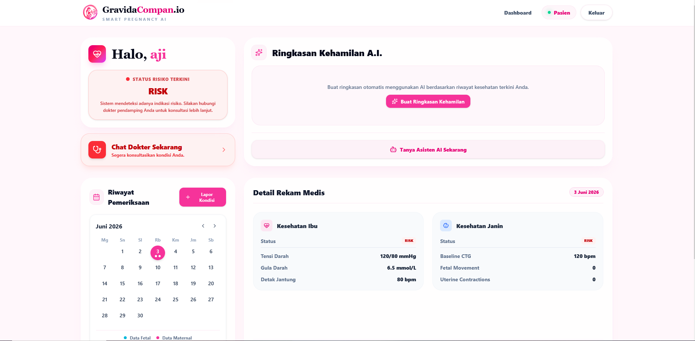
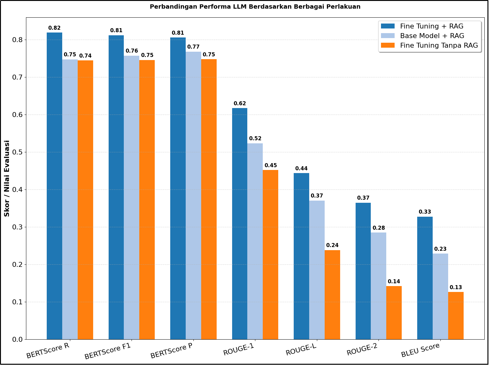
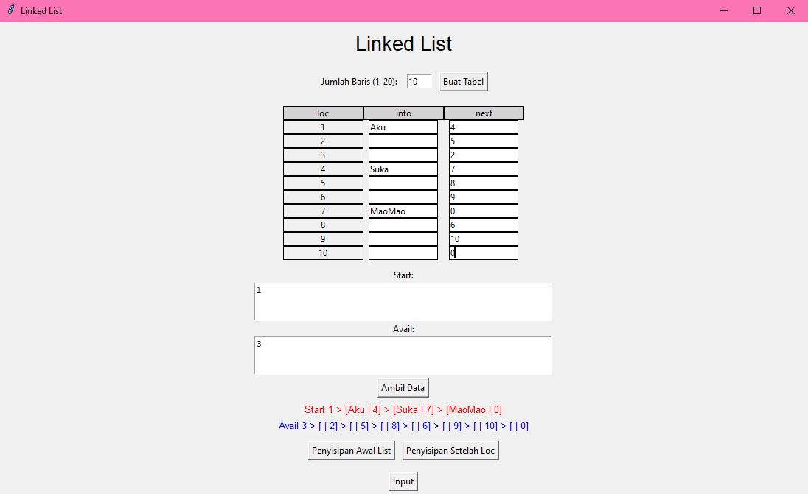
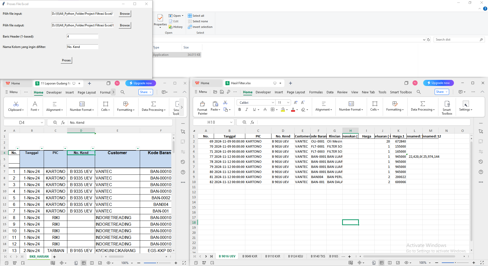

<!-- ============================== HEADER ============================== -->

 

  

---

## 👋 About Me

I'm a **beginner developer** currently diving into **AI Development**, **Backend Engineering**, and **Data Analysis**, while actively contributing to open-source projects. My goal is to keep learning and growing in these fields every day.

Beyond programming, I have a strong interest in **mathematics, science, and music**, and I often build projects around those topics. My curiosity doesn't stop there — I'm always eager to explore new domains and broaden my horizons.

|  |  |
|---|---|
| 🔭 **Studying** | Student at [**Gunadarma University**](https://campus.quipper.com/directory/universitas-gunadarma) |
| 🌱 **Learning** | Object-Oriented Programming & AI Engineering |
| 👯 **Collaborating** | Open-source projects, especially **Python** |
| 🤔 **Interested in** | Backend Programming · Software/Mobile Apps · Data Analysis · Artificial Intelligence |
| 💬 **Ask me about** | Artificial Intelligence, Data Manipulation, Music, or even Mathematics |
| 📫 **Reach me at** | [raintxhanx@gmail.com](mailto:raintxhanx@gmail.com) |
| ⚡ **Fun fact** | Excel is one of my favorite tools — I use it for data analysis and also for my hobby, **"Theory Crafting"**, where I dive deep into game mechanics. |

---

## 🔧 Tech Stack

<table>
  <tr>
    <td><b>Languages</b></td>
    <td>
      
    </td>
  </tr>
  <tr>
    <td><b>AI / ML & Data</b></td>
    <td>
      
       
      
      
       
      <i>🌱 Beginner in PyTorch &amp; TensorFlow — learning every day</i>
    </td>
  </tr>
  <tr>
    <td><b>Desktop / GUI</b></td>
    <td>
      
    </td>
  </tr>
  <tr>
    <td><b>Databases</b></td>
    <td>
      
    </td>
  </tr>
  <tr>
    <td><b>Tools & DevOps</b></td>
    <td>
      
    </td>
  </tr>
</table>

---

## 🚀 Featured Projects

<table width="100%">
  <thead>
    <tr>
      <th width="50%" align="center">🤰 GravidaCompan.io</th>
      <th width="50%" align="center">💬 GravidaChatbot</th>
    </tr>
  </thead>
  <tbody>
    <tr>
      <td></td>
      <td></td>
    </tr>
    <tr>
      <td valign="top">A web-based platform for integrated pregnancy monitoring and AI-powered early pregnancy risk detection. It also features an interactive communication system that connects expectant mothers with obstetricians for online consultations, continuous medical guidance, and personalized support.</td>
      <td valign="top">An LLM-powered medical Q&amp;A system that supports expectant mothers through preventive health education and stunting prevention. It operates entirely in <b>Bahasa Indonesia</b> and covers pregnancy, prenatal care, childbirth, postpartum care, and related maternal health topics.</td>
    </tr>
    <tr>
      <td align="center">
        
        
      </td>
      <td align="center">
        
        
      </td>
    </tr>
    <tr>
      <td align="center"><a href="https://github.com/Raintxhanx/GravidaCompan.io"><b>📂 View Repository</b></a></td>
      <td align="center"><a href="https://github.com/Raintxhanx/GravidaChatbot"><b>📂 View Repository</b></a></td>
    </tr>
  </tbody>
</table>

<table width="100%">
  <thead>
    <tr>
      <th width="50%" align="center">🗺️ Interactive Campus Map</th>
      <th width="50%" align="center">🤖 Personal Discord Bot</th>
    </tr>
  </thead>
  <tbody>
    <tr>
      <td></td>
      <td></td>
    </tr>
    <tr>
      <td valign="top">A prototype web app with an interactive map showing the distribution of campuses across Indonesia, stored in a database. Users can add new data and filter campuses by their own criteria.</td>
      <td valign="top">A personal Discord bot that automates tasks in a server and simulates the <b>Genshin Impact</b> pull (gacha) mechanics.</td>
    </tr>
    <tr>
      <td align="center">
        
        
      </td>
      <td align="center">
        
        
      </td>
    </tr>
    <tr>
      <td align="center"><a href="https://github.com/Raintxhanx/Interactive-Campus-Map"><b>📂 View Repository</b></a></td>
      <td align="center"><a href="https://github.com/Raintxhanx/Personal-Discord-Bot"><b>📂 View Repository</b></a></td>
    </tr>
  </tbody>
</table>

<table width="100%">
  <thead>
    <tr>
      <th width="50%" align="center">🔗 Linked List Visualizer</th>
      <th width="50%" align="center">📊 Excel Sheet Extraction</th>
    </tr>
  </thead>
  <tbody>
    <tr>
      <td></td>
      <td></td>
    </tr>
    <tr>
      <td valign="top">A desktop application built with PyQt that visualizes the linked list data structure. Users can input data under specific conditions or manipulate the structure, and the program dynamically displays the resulting linked list.</td>
      <td valign="top">A Windows executable that extracts data based on a keyword in a chosen column, then organizes the filtered data into a new Excel file, with each unique keyword placed in its own dedicated sheet.</td>
    </tr>
    <tr>
      <td align="center">
        
        
      </td>
      <td align="center">
        
        
        
      </td>
    </tr>
    <tr>
      <td align="center"><a href="https://github.com/Raintxhanx/Linked-List-Visualizer"><b>📂 View Repository</b></a></td>
      <td align="center"><a href="https://github.com/Raintxhanx/Excel-Sheet-Extraction-"><b>📂 View Repository</b></a></td>
    </tr>
  </tbody>
</table>

---

## 📊 GitHub Stats

 

### 📈 Contribution Activity

  

### 🏆 Trophies

  

### 🐍 Contribution Snake

  <picture>
    <source media="(prefers-color-scheme: dark)" srcset="https://raw.githubusercontent.com/Raintxhanx/Raintxhanx/output/github-snake-dark.svg" />
    <source media="(prefers-color-scheme: light)" srcset="https://raw.githubusercontent.com/Raintxhanx/Raintxhanx/output/github-snake.svg" />
    
  </picture>

---

## 📣 Let's Collaborate

- 🤝 I'm always open to **collaborating** on **open-source projects**, especially **Python** ones.
- 💡 Interested in working together, or just want to chat about tech, AI, data, music, or math? Feel free to reach out!

**Thanks for visiting my profile!** 🙌

